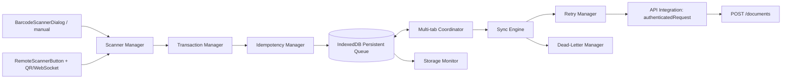
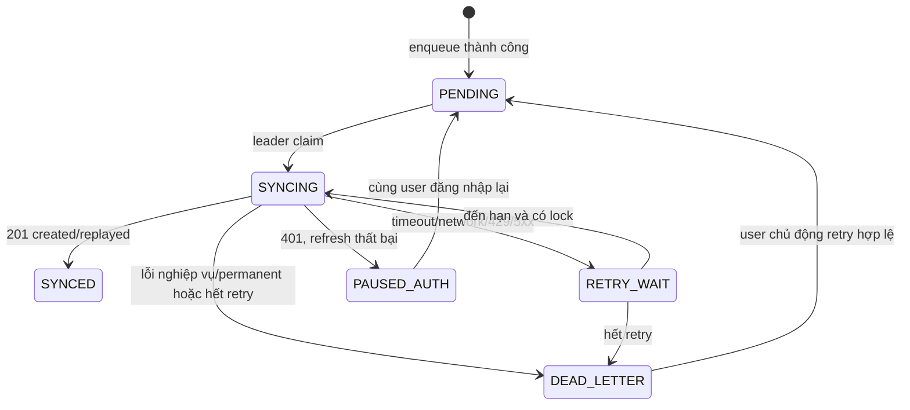
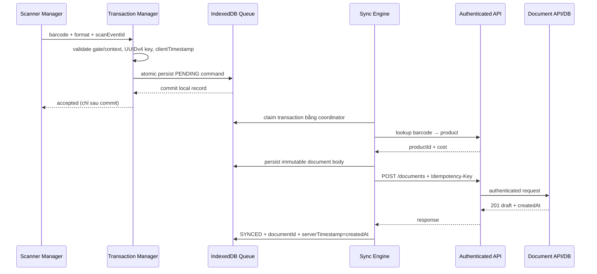

# P03 – SV2 Software Architecture & Technical Design

**Trạng thái:** Được user phê duyệt để triển khai client trong P04; các phụ thuộc P02 cho API/DB/runtime vẫn chưa được đóng.  
**Cơ sở:** P01 implementation/source review và `docs/P02-integration-readiness.md`. P02 kết luận **NOT READY**. Những phần liên quan contract/backend chỉ được thay đổi sau khi SV3/SV4 xác nhận; P04 không tự sửa contract.

## 1. Mục tiêu và nguyên tắc

1. Mỗi scan được chấp nhận tạo một transaction command bền vững và cuối cùng tạo một **phiếu nháp riêng**. Không xác nhận phiếu, không cập nhật tồn khi scan.
2. Tái sử dụng camera ZXing, QR pairing/WebSocket, API auth client, `/documents`, model phiếu và transaction DB hiện có. Không tạo scanner transport, auth client hoặc stock engine thứ hai.
3. Persist command trước network; khi retry giữ nguyên `idempotency_key` và request body đã đóng băng.
4. `scanEventId` nhận diện scan; `idempotency_key` nhận diện lệnh API. Hai giá trị không dùng thay thế nhau.
5. Backend là nguồn chuẩn cho user, thời gian server, quyền và kết quả giao dịch. Client không gửi user identity đáng tin cậy.
6. Chỉ dùng IndexedDB/Web Locks/BroadcastChannel của browser; không thêm thư viện nếu chưa được duyệt.
7. P02 blocker về idempotency theo principal, DB test/staging và contract approval phải đóng trước tích hợp runtime.

## 2. Kiến trúc đề xuất

### 2.1 Component boundaries và tái sử dụng

| Trách nhiệm logic | Vai trò | Module hiện có được tái sử dụng | Thiết kế đích |
|---|---|---|---|
| **Scanner Manager** | Nhận scan từ camera/manual hoặc điện thoại, chuẩn hóa thành barcode/format/event ID; không ghi phiếu/tồn | `BarcodeScannerDialog.tsx`; `RemoteScannerButton.tsx`; `ScannerConnectionDialog.tsx`; `scannerService.ts`; `types.ts` (`ScanEvent`) | Giữ các transport hiện hữu. `GateScannerDialog.tsx` tiếp nhận cả hai nguồn qua một callback; không tạo camera/QR manager thứ hai. |
| **Transaction Manager** | Chụp snapshot gate, hướng IN/OUT, kho, supplier/partner, quantity và scan time; tạo một lệnh cho một scan | `GateScannerDialog.tsx`; entry point trong `DocumentsPage.tsx` | Refactor orchestration trong feature hiện hữu; không thay basket/draft form cũ vốn có semantics gom nhiều scans vào một draft. |
| **Idempotency Manager** | Tạo UUID v4 cho mỗi command; giữ key và canonical body bất biến; phân biệt scan event key với request key | Phần tạo key/command hiện nằm trong `gateTransactions.ts` | Một policy duy nhất trong luồng gate. Backend phải scope key theo principal trước khi release. Không dùng barcode, event ID hay timestamp làm key. |
| **Persistent Queue** | Lưu command, payload đã resolve, state và lịch retry qua reload/crash | Queue hiện lưu LocalStorage trong `gateTransactions.ts` | IndexedDB làm nguồn dữ liệu bền vững. Không tạo thêm LocalStorage queue song song; chỉ dual-read một lần khi migrate queue P01. |
| **Sync Engine** | Chọn lệnh eligible theo thứ tự, lấy lock, gọi API tuần tự hoặc với giới hạn concurrency đã chốt, cập nhật trạng thái | Sync loop hiện ở `gateTransactions.ts` | Một coordinator theo user và origin; ưu tiên thứ tự scan trong cùng user/gate. Không dùng event WebSocket scan làm cơ chế sync transaction. |
| **Retry Manager** | Phân loại lỗi retryable/permanent/auth, exponential backoff có jitter, tôn trọng `Retry-After` | Backoff hiện ở `gateTransactions.ts`; HTTP error status/code ở `authClient.ts` | Tách classifier/backoff thành responsibility rõ ràng; retry cùng body/key; giới hạn số lần theo policy được duyệt. |
| **Dead-Letter Manager** | Giữ lệnh lỗi không tự hồi phục, lỗi cuối và chi tiết phản hồi; hỗ trợ retry có chủ ý/tra cứu | Trạng thái `DEAD_LETTER` hiện ở queue/UI | DLQ nằm trong cùng IndexedDB store; không xóa lỗi hay đổi payload khi retry. Sửa nghiệp vụ tạo command mới và key mới. |
| **Storage Monitor** | Theo dõi quota, estimate, queue size và lỗi persistence; ngăn báo “đã nhận” nếu write chưa thành công | Chưa có component riêng | Gọi `navigator.storage.estimate()` khi hỗ trợ; quota/write failure phải chặn enqueue và báo rõ. Không tự xóa pending/DLQ để giải phóng dung lượng. |
| **Multi-tab Coordinator** | Chọn một tab sync, phát hiện enqueue/state changes, phục hồi leader khi tab crash | Web Locks + lease LocalStorage hiện nằm trong `gateTransactions.ts` | Dùng Web Locks làm leader lock; BroadcastChannel báo queue changes. Fallback dùng lease được cập nhật atomically trong IndexedDB transaction; không dựa lease LocalStorage hiện tại vì race. Server idempotency vẫn là hàng rào cuối. |
| **API Integration Layer** | Map command thành lookup/product + `POST /documents`; dùng token refresh, decode error/status và response | `authenticatedRequest()` trong `authClient.ts`; endpoint document hiện có | Adapter nhỏ trong feature scanner gọi auth client hiện hữu; không tạo fetch/auth stack mới. Header `Idempotency-Key`; API path giữ nguyên. |

Các component trên là **ranh giới trách nhiệm**, không yêu cầu tạo mười module mới. Tối thiểu có thể giữ transaction facade tại `gateTransactions.ts`, bổ sung một IndexedDB store và coordinator; chỉ tách file khi tests/maintainability yêu cầu.

### 2.2 Luồng tổng thể



## 3. Transaction data contract

### 3.1 Envelope và field ownership

Một envelope local có thể biểu diễn như sau (mô tả thiết kế, **không phải mã/schema đã triển khai**):

```text
GateTransaction {
  idempotency_key: UUIDv4
  scan_event_id: UUID
  barcode: string
  quantity: positive integer
  type: "Nhập kho" | "Xuất kho"
  scan_point: "GATE_A" | "GATE_B"
  client_timestamp: ISO-8601 timezone-aware
  server_timestamp: ISO-8601 timezone-aware | null
  user_id: UUID
  device_id: UUID | null
  warehouse_id: UUID
  supplier_id: UUID | null
  partner: string
  request_body: canonical POST /documents JSON | null until product resolution
  state: queue state
  local metadata: queue ID, attempts, retry time, last error, document ID, version
}
```

API request giữ nguyên document contract đang có: `type`, `warehouseId`, `supplierId` cho IN, `partner` cho OUT, `note`, `lines[{productId,quantity,unitCost}]`, metadata hiện có `scanPoint`, `scanEventId`, `clientTimestamp`; `idempotency_key` đi ở header `Idempotency-Key`. API hiện không nhận `barcode`, `user_id`, `device_id` hoặc `server_timestamp` như các field riêng.

### 3.2 Field matrix

| Field thiết kế | Phân loại | Kiểu / bắt buộc | Validation/default | Nơi lưu và mapping | Tương thích / tác động SV3-SV4 |
|---|---|---|---|---|---|
| `idempotency_key` | Local + API header + DB | UUID v4; bắt buộc cho mỗi transaction | `crypto.randomUUID()`; fail-closed nếu không có; bất biến qua retry | IndexedDB; HTTP header; DB `idempotency_requests` | Header đang có. Cần SV3/SV4 scope theo user/principal; hiện PK toàn cục là blocker. Không thêm vào JSON body. |
| `barcode` | Local; API/DB hiện chưa có field riêng | string; bắt buộc với scan | Trim; không rỗng; registered Product barcode hiện tối đa 160 ký tự. Gate manual input và scanner-event API cho phép tối đa 300, nên transaction manager phải từ chối mã không thể khớp Product thay vì âm thầm cắt chuỗi. Không suy diễn barcode từ SKU. | IndexedDB; resolve thành `productId`; có thể giữ trong local audit/DLQ | Không lưu được barcode lịch sử trong `stock_documents` hiện tại. Nếu SV3 yêu cầu traceability server-side, đề xuất field additive `scanBarcode` nullable (1–160 ký tự theo giới hạn Product, trimmed) và cột nullable `scan_barcode`; không gửi trước khi SV3 duyệt. |
| `quantity` | Local + API document line + DB line | integer > 0; bắt buộc | Mặc định 1 tại UI; chụp snapshot mỗi scan; không nhận float/0/âm | Queue; `lines[].quantity`; `stock_document_items.quantity` | API/DB hiện có. Không đổi nghĩa hoặc stock timing. |
| `type` | Local + API + DB | Literal IN/OUT; bắt buộc | `GATE_A` chỉ `Nhập kho`; `GATE_B` chỉ `Xuất kho` | Queue; `type`; `stock_documents.type` | Hiện có; SV3 chốt gate semantics. |
| `scan_point` / API `scanPoint` | Local + API + DB | `GATE_A`/`GATE_B`; bắt buộc với gate transaction | Enum; gate/type phải đúng; không default ngầm | Queue; body `scanPoint`; DB `scan_point` | Field API/DB additive hiện có trong source/migration 0009; SV3 cần phê duyệt contract/deploy. |
| `client_timestamp` / API `clientTimestamp` | Local + API + DB | timezone-aware datetime; bắt buộc cho transaction scan theo thiết kế | Gán lúc scan được chấp nhận; không thay đổi khi retry; không tin dùng làm server chronology | Queue; body; DB `client_timestamp` | API/DB hiện optional. Đề nghị làm required trong luồng gate client, nhưng chưa yêu cầu bắt buộc toàn `/documents` để giữ tương thích client cũ; SV3 phê duyệt. |
| `server_timestamp` | Response/local derived; không gửi request | nullable trước response; sau success nhận server datetime | Dùng `createdAt` hiện tại làm thời gian server chuẩn; không lấy đồng hồ client | Response `createdAt`; DB `stock_documents.created_at`; cache local trong response | Không đề xuất thêm field/cột trùng. Nếu contract bắt buộc tên `serverTimestamp`, SV3 phải chốt alias additive với `createdAt`, không đổi/xóa `createdAt`. |
| `user_id` | Local partition + DB derived; không phải request field | UUID; bắt buộc với queue record | Lấy từ authenticated `AuthContext`; trước khi sync xác nhận principal hiện tại trùng queue owner | IndexedDB key/index theo user; API access token; DB `created_by_user_id` từ `CurrentUser` | Không gửi user ID để backend tin cậy; SV4 quyết định quyền resume queue và document ownership. DB column hiện nullable cho legacy. |
| `device_id` | Local metadata; API/DB hiện chưa có | UUID optional | Random UUID per browser installation; không fingerprint; không dùng làm auth; reset khi storage bị xóa | IndexedDB metadata | Không gửi/lưu server mặc định. Nếu audit cần thiết, SV3/SV4 phải duyệt retention/privacy và field mới. QR event có `deviceId?` riêng, không đồng nhất tự động. |
| `scan_event_id` / API `scanEventId` | Local + API + DB | UUID; bắt buộc cho gate | QR nhận event ID từ transport; camera/manual tạo UUID riêng; retry giữ nguyên | IndexedDB; body; unique nullable DB column `stock_documents.scan_event_id` | API/DB hiện có. Không sử dụng làm idempotency key. SV3 chốt UUID format và uniqueness scope. |
| `warehouse_id`, `supplier_id`, `partner` | Local + API + DB | Warehouse bắt buộc; supplier bắt buộc với IN; partner bắt buộc OUT | Chụp snapshot theo cấu hình tại thời điểm scan; backend xác minh tồn tại/active | IndexedDB; request camelCase; document columns/FK | Contract hiện có. SV3 xác nhận “một scan→một draft” và cách user thay đổi cấu hình khi queue còn pending. |
| `request_body` | Queue-only snapshot/API JSON | Nullable trước resolve, bắt buộc trước POST | Freeze sau product lookup; mọi retry serialize đúng cùng JSON values | IndexedDB; HTTP POST body | API cũ giữ nguyên. Không dựng lại body từ UI state cho retry. |
| `state`, `attempt_count`, `next_attempt_at`, `last_error`, `document_id`, `queued_at`, `updated_at`, `schema_version` | Local queue metadata | Bắt buộc theo state; `document_id` nullable | DB schema-version migration; không gửi API | IndexedDB | Không tác động SV3/SV4. Không lưu access/refresh token hoặc credential trong queue. |

### 3.3 Đề xuất additive API/DB nếu SV3 yêu cầu barcode traceability

Field `barcode` có trong scan command nhưng không nằm trong document request/DB hiện tại. Đối chiếu từ `productId` cho biết sản phẩm hiện tại, nhưng không chứng minh barcode nào đã được quét nếu barcode sản phẩm đổi sau này.

Đề xuất **chưa chấp thuận/chưa triển khai**:

| Tên | Kiểu | Required | Validation/default | Nơi lưu | Tương thích | Bên ảnh hưởng |
|---|---|---|---|---|---|---|
| `scanBarcode` | API string; DB nullable `TEXT` (hoặc `VARCHAR(160)` nếu schema convention yêu cầu) | Optional trên `/documents`; required khi `scanPoint` khác null nếu SV3 chọn audit barcode | Trim; 1–160 ký tự; không chứa chuỗi rỗng; backend đối chiếu product/barcode theo policy được chốt | API request/response; `stock_documents.scan_barcode`; queue vẫn giữ `barcode` | Nullable/additive cho phiếu cũ và client cũ; không sửa `lines[].productId` hay barcode field của Product | SV3 schema/serializer/migration/tests; SV4 audit/access; frontend type/queue. Không đổi tên field cũ. |

Không đề xuất thêm `server_timestamp` column: `created_at` hiện là thời gian DB/server của document. `client_timestamp` vẫn là dữ liệu thiết bị riêng.

## 4. State machine

Tên `PAUSED_AUTH` dùng thay cho code hiện tại `AUTH_REQUIRED`; mapping phải được xử lý khi migrate queue.

| State | Ý nghĩa | Cho phép chuyển sang |
|---|---|---|
| `PENDING` | Persisted; đủ business context; chờ sync | `SYNCING`, `DEAD_LETTER` nếu local validation phát hiện lỗi trước network |
| `SYNCING` | Một leader tab đang xử lý; request có thể đang lookup hoặc POST | `SYNCED`, `RETRY_WAIT`, `PAUSED_AUTH`, `DEAD_LETTER` |
| `SYNCED` | Backend trả document ID/response; terminal thành công | Không chuyển; chỉ purge sau retention policy được duyệt |
| `RETRY_WAIT` | Lỗi tạm thời; `next_attempt_at` được persist | `SYNCING`, `PAUSED_AUTH`, `DEAD_LETTER` |
| `PAUSED_AUTH` | 401/refresh thất bại hoặc principal không còn session; không retry nền | `PENDING` chỉ sau login lại bằng đúng `user_id`; nếu account khác đăng nhập giữ nguyên partition và pause |
| `DEAD_LETTER` | Request không retry tự động: validation/business 4xx, mismatch 409, hết retry hoặc dữ liệu local hỏng | `PENDING` chỉ qua thao tác retry rõ ràng nếu payload vẫn hợp lệ; chỉnh nghiệp vụ tạo transaction/key mới |

Quy tắc:
- Không tự tăng lại quantity hay sinh idempotency key trong retry.
- `403` là authorization/permission, không phải auth-expiry; đưa `DEAD_LETTER`/needs-review, không lặp liên tục.
- `401` để API client thử refresh theo cơ chế hiện có; nếu refresh vẫn thất bại thì `PAUSED_AUTH`.
- Network error, timeout, 408/425/429, 5xx: retry có backoff + jitter; tôn trọng `Retry-After`; sau giới hạn attempts → `DEAD_LETTER`.
- 400/404/422 và `409` key/body mismatch: không tự sửa payload. 409 scan-event conflict cần hiển thị để xử lý; duplicate same-content phải được backend trả replay thành công.
- Recovery: tab mới được quyền sync reset `SYNCING` cũ chỉ sau khi xác nhận lock/lease hết hạn; server idempotency bảo vệ trường hợp request trước đã commit.



## 5. Sequence diagrams

### 5.1 Online scan



### 5.2 Offline scan và reconnect

```mermaid
sequenceDiagram
  participant S as Scanner
  participant Q as IndexedDB
  participant E as Sync Engine
  participant A as API
  S->>Q: persist scan command + UUIDv4 key
  Q-->>S: commit; UI báo đã xếp hàng cục bộ
  E->>A: lookup hoặc POST khi thử sync
  A--xE: network unavailable
  E->>Q: RETRY_WAIT + next_attempt_at; giữ nguyên key
  Note over S,Q: barcode/product phải có trong frontend data để nhận scan offline
  Note over E,A: reconnect/online event đánh thức sync; resolve product nếu body chưa freeze
  E->>A: lookup → persist body → POST cùng key/body
  A-->>E: 201 draft
  E->>Q: SYNCED
```

### 5.3 Retry, duplicate scan và duplicate API request

```mermaid
sequenceDiagram
  participant C as Client Queue
  participant A as POST /documents
  participant DB as PostgreSQL
  C->>C: tìm scanEventId đã có trong queue
  alt event đã queue cùng nội dung
    C-->>C: không tạo thêm local command
  else command mới
    C->>A: POST body B, key K
    A->>DB: insert idempotency row (K, hash(B))
    A->>DB: tạo draft + lưu response
    DB-->>A: commit
    A--xC: response bị mất/timeout
    C->>A: retry chính xác B, K
    A->>DB: đọc idempotency row K
    DB-->>A: hash giống, response đã lưu
    A-->>C: replay 201 + cùng document id
  end
  Note over A,DB: cùng K nhưng body khác phải 409; cùng scanEventId conflict/identical được xử lý riêng
```

### 5.4 Server commit nhưng client timeout

```mermaid
sequenceDiagram
  participant E as Sync Engine
  participant API as API
  participant DB as PostgreSQL
  participant Q as IndexedDB Queue
  E->>API: POST body B + key K
  API->>DB: transaction: document + items + audit + idempotency response
  DB-->>API: COMMIT
  API--xE: response lost / timeout
  E->>Q: RETRY_WAIT; body B và key K không đổi
  E->>API: POST body B + key K
  API->>DB: load idempotency K
  DB-->>API: replay stored response
  API-->>E: 201 same documentId
  E->>Q: SYNCED
```

### 5.5 Authentication expired và Dead-Letter

```mermaid
sequenceDiagram
  participant E as Sync Engine
  participant AC as authClient hiện có
  participant API as API
  participant Q as Queue
  E->>AC: request authenticated
  AC->>API: request access token
  API-->>AC: 401
  AC->>API: refresh hiện có (một lần)
  alt refresh thành công, cùng principal
    API-->>AC: token mới
    AC->>API: retry cùng request
    API-->>E: response
  else refresh thất bại/session hết hạn
    AC-->>E: auth error
    E->>Q: PAUSED_AUTH; không tự retry
    Note over Q: chỉ resume khi user đăng nhập lại cùng user_id
  end
  opt lỗi permanent 400/403/404/409 mismatch/422 hoặc retry exhausted
    E->>Q: DEAD_LETTER + code/message + body giữ nguyên
    E-->>Q: yêu cầu người dùng xem; không âm thầm tạo body/key mới
  end
```

### 5.6 Multi-tab synchronization/recovery

```mermaid
sequenceDiagram
  participant T1 as Tab leader
  participant T2 as Tab khác
  participant L as Web Locks / IDB lease
  participant Q as IndexedDB
  participant API as API
  T1->>L: acquire exclusive lock theo user
  T1->>Q: claim/read PENDING batch
  T2->>Q: persist scan mới PENDING
  T2-->>T1: BroadcastChannel(queue changed)
  T1->>Q: drain lệnh mới theo thứ tự
  T1->>API: request với key ổn định
  Note over T1,L: tab crash làm lock tự nhả; IDB fallback lease hết hạn và được atomically acquire
  T2->>L: acquire sau crash/lock release
  T2->>Q: recover stale SYNCING → eligible
  T2->>API: retry cùng body/key nếu cần
  API-->>T2: created/replayed result
```

## 6. Storage strategy

| Tiêu chí | LocalStorage hiện tại | IndexedDB đề xuất |
|---|---|---|
| Dữ liệu nhiều record/body | Synchronous string serialize toàn queue; quota nhỏ, write có thể block main thread | Object records, async, phù hợp queue lớn hơn và binary/metadata nếu cần |
| Atomicity | Không transaction; read-modify-write dễ race; state/key và queue cùng chuỗi lớn | Transaction atomic cho put/update/index/lease; unique index có thể chống duplicate local IDs |
| Multi-tab | `storage` event chỉ thông báo; lease read/write không atomic | Shared origin database; transaction atomic cho claim/lease; kết hợp Web Locks/BroadcastChannel |
| Crash/reload | Dữ liệu sống qua reload nhưng ghi queue nguyên khối và quản lý migration khó | Dữ liệu structured, transaction commit rõ; browser vẫn có quyền eviction/clear |
| Quota | Có thể ném `QuotaExceededError`; hiện không có monitor | Quota vẫn hữu hạn nhưng `navigator.storage.estimate()`/`persist()` có thể hỗ trợ; phải handle failure |
| Query state | Đọc toàn bộ, lọc/scan O(n) | Index theo user, state, queued time, retry time |
| Độ phức tạp | Thấp | Cao hơn; schema versioning, IDB upgrade/blocked handling cần test |

**Quyết định thiết kế:** IndexedDB làm persistent queue duy nhất. LocalStorage chỉ được dùng tạm trong migration từ queue P01; migration phải đọc record, validate, ghi vào IDB transaction, xác nhận commit rồi mới xóa record cũ. Nếu migration thất bại, giữ LocalStorage nguyên trạng và chặn sync trùng. Không lưu credential/token trong cả hai store.

**Quota policy cần phê duyệt:** monitor estimate, cảnh báo ngưỡng (đề xuất 80% quota origin), giới hạn queue soft/hard theo số record/bytes; khi put thất bại thì không nhận scan như “đã lưu”. Không purge `PENDING`, `RETRY_WAIT`, `PAUSED_AUTH`, `DEAD_LETTER`. Chỉ cleanup `SYNCED` sau retention được SV3/SV4 duyệt và đảm bảo `documentId` đã được persist.

## 7. Test Strategy – KT1 đến KT15

### 7.1 Unit tests (không cần DB/browser)

| ID | Kịch bản | Kết quả mong đợi |
|---|---|---|
| KT1 | Gate/type validation A/IN, B/OUT và mismatch | Chỉ đúng mapping được enqueue; mismatch không gửi |
| KT2 | EAN-13 checksum, barcode rỗng/quá dài/format khác | Checksum áp dụng cho EAN-13; format khác không bị EAN rule nhầm; invalid không enqueue |
| KT3 | Quantity 0, âm, thập phân, integer dương | Chỉ positive integer được nhận |
| KT4 | Tạo nhiều transaction key | UUID v4 duy nhất; `idempotency_key !== scan_event_id`; thiếu secure random fail-closed |
| KT5 | `client_timestamp` và context snapshot | Ghi timezone-aware timestamp một lần; đổi form sau scan không sửa lệnh đang queue |
| KT6 | Canonical request body retry | Serialize body cố định; retry giữ nguyên bytes/semantic JSON và header key sau lookup/timeout |
| KT7 | State transition/classifier | Mỗi error class chuyển đúng state; 401 khác 403; Retry-After/backoff có giới hạn/jitter |
| KT8 | Local duplicate scanEventId | Cùng event không tạo hai queue records; event ID khác cho barcode giống tạo lệnh riêng |
| KT9 | DLQ/manual retry | Permanent errors giữ body/key/error; explicit retry cùng lệnh giữ key; sửa command sinh key mới |
| KT10 | Storage monitor/quota failure | Lỗi write không phản hồi “accepted”; không purge queue để nhường dung lượng |

### 7.2 PostgreSQL integration tests

| ID | Kịch bản | Assertions |
|---|---|---|
| KT11 | POST draft + replay cùng key, cùng body | Một stock document/items; hai response cùng `id`; không đổi inventory; idempotency row và audit đúng |
| KT12 | Cùng key/body khác và cross-principal cùng key/body | 409 theo policy; không trả/replay response principal khác; không phát sinh phiếu thứ hai |
| KT13 | Cùng scanEventId replay giống và conflict khác; concurrent requests | Unique/advisory serialization; một draft; deterministic 201 replay hoặc 409; user attribution đúng |
| KT14 | Confirm inbound/outbound, insufficient stock, rollback | Draft không đổi tồn; confirm đổi đúng một lần; movement/audit/status atomic; lỗi rollback mọi line |

### 7.3 Browser E2E / runtime

| ID | Kịch bản | Assertions |
|---|---|---|
| KT15 | Two tabs + reload/crash + auth expiry + server commit/response timeout | Một logical draft; queue phục hồi; cùng user đăng nhập lại có thể resume; user khác không sync queue; lock/lease recovery và BroadcastChannel đạt |

KT15 cần chia test cases trong browser suite thay vì một test khổng lồ. Browser E2E bổ sung: camera permission granted/denied, HTTPS check, decode barcode fixture, close/unmount tracks, offline→online, LocalStorage-to-IDB queue migration. Camera vật lý vẫn cần manual device test; browser automation giả lập camera không được gọi là camera E2E thực.

**Regression:** chạy toàn bộ backend unit suite, PostgreSQL 7-test suite (không skip, chỉ DB test/staging), `npm run build`, routing contract tests; thêm Playwright/browser automation chỉ sau khi dependency và browser matrix được duyệt. Không thay test DB bằng mock cho transaction/constraint assertions.

## 8. Implementation plan sau khi được duyệt

### 8.1 File dự kiến tạo

- `src/features/scanner/gateQueueStore.ts` — IndexedDB versioning, transaction CRUD/index/atomic lease và migrate từ LocalStorage.
- `src/features/scanner/gateTransaction.test.ts` hoặc vị trí test theo convention đang được thống nhất — unit tests queue/state/retry/idempotency.
- Browser E2E test mới tại vị trí test tooling được chọn; chưa thêm Playwright trước khi duyệt dependency.
- Migration backend mới chỉ nếu SV3/SV4 duyệt scope theo principal và/hoặc barcode traceability. Không ấn định revision ID trước khi kiểm tra migration graph tại thời điểm triển khai.

### 8.2 File dự kiến sửa

- `src/features/scanner/gateTransactions.ts` — facade/orchestration, chuyển từ LocalStorage lease sang store/coordinator; retry/state machine.
- `src/features/scanner/GateScannerDialog.tsx` — trạng thái queue/auth/storage feedback và dùng facade; không thay scanner UI ngoài yêu cầu.
- `src/features/scanner/BarcodeScannerDialog.tsx` không phải path hiện tại: camera component thực tế là `src/components/BarcodeScannerDialog.tsx`; chỉ sửa nếu E2E phát hiện lifecycle defect.
- `src/pages/DocumentsPage.tsx` — chỉ giữ entry point GATE_A/B hiện có; chỉ sửa khi API contract/policy yêu cầu.
- `src/types.ts` — metadata/response fields nếu schema SV3 chốt.
- `src/features/auth/authClient.ts` — dự kiến không đổi; tiếp tục dùng `authenticatedRequest`. Chỉ thay nếu cần export error typing mà không phá refresh flow.
- Có điều kiện sau approval: `backend/app/schemas.py`, `backend/app/models/entities.py`, `backend/app/services/serialization.py`, `backend/app/api/v1/endpoints/documents.py`, Alembic migration và PostgreSQL tests để scope idempotency theo principal/scanBarcode.

### 8.3 File/luồng không được sửa trong phạm vi kiến trúc này

- Không viết lại hoặc thay endpoint/semantics của `scannerService.ts`, `ScannerConnectionDialog.tsx`, QR nonce, device/owner token hay WebSocket protocol.
- Không thay stock confirmation, `inventory`, `stock_movements`, document status, hay cho scan tự đổi tồn.
- Không tạo auth/token manager thứ hai; không tin `user_id`/`device_id` từ client làm principal.
- Không đổi/xóa field API cũ (`type`, `warehouseId`, `supplierId`, `partner`, `note`, `lines`, `createdAt`) hoặc triển khai field đề xuất trước SV3/SV4 approval.
- Không chạy migration/database operation ngoài DB test/staging đã được owner xác nhận; không truy cập production.

### 8.4 Dependency và thứ tự

1. SV3/SV4 phê duyệt document contract, response/server-time, retry/error semantics, RBAC/gate, idempotency scope và quyết định barcode/device metadata. Idempotency principal scope là blocker bảo mật/integrity cần ưu tiên.
2. DB owner cấp xác nhận bằng văn bản cho DB test/staging; kiểm tra migration graph/current/schema và backup/rollback policy trên đúng DB đó.
3. Chốt queue state machine, retention/quota policy, supported browser matrix và quyết định IndexedDB/Web Locks fallback.
4. Viết KT1–KT10 và unit implementation; review migration kế hoạch queue P01 → IndexedDB.
5. Implement store migration + multi-tab coordinator + recovery; chạy test browser hai tab/crash.
6. Sau security/contract approval, sửa API/schema/migration để scope idempotency và barcode field nếu được duyệt; chạy PostgreSQL KT11–KT14.
7. Tích hợp UI/API adapter; test auth refresh, runtime draft/replay/confirm trên DB test.
8. Browser automation, camera device E2E, regression suite và release review; chỉ khi đạt mới chuyển READY.

Dependencies dự kiến: IndexedDB, `navigator.locks`, `BroadcastChannel`, `navigator.storage.estimate`; không thêm package runtime. Browser thiếu Web Locks phải dùng atomic IndexedDB lease đã test; browser thiếu IndexedDB thì gate transaction phải disable rõ ràng, không fallback âm thầm sang non-atomic LocalStorage.

### 8.5 Rollback strategy

- Frontend release có feature flag để disable gate transaction creation/sync; giữ QR scanner/document form hiện hữu. Flag không đổi hay xác nhận các transaction đã tạo.
- Khi chuyển LocalStorage → IndexedDB: dual-read/migrate theo record ID, verify commit trước khi remove nguồn cũ; rollback app version phải vẫn đọc được dữ liệu queue hoặc cung cấp export/import. Không bỏ queue pending/DLQ khi rollback.
- DB dùng expand-first, nullable/additive migration. Rollback code frontend/API trước; giữ cột mới và dữ liệu khi đã có records. Không downgrade destructive migration sau khi có production data.
- Với idempotency scoping migration, giữ legacy records và quy định collision/replay policy trước deploy; không truncate `idempotency_requests`.
- Nếu server đã commit nhưng client chưa nhận response, giữ body/key để retry; không tạo draft thay thế. Nếu payload cần chỉnh, tạo lệnh mới sau khi xử lý DLQ và tra document cũ.
- Không áp bất kỳ rollback/migration lên production trong giai đoạn P03.

## 9. Approval gate

Chờ phê duyệt của SV2/SV3/SV4 cho: (1) idempotency scope theo principal; (2) metadata gate/time và response `createdAt`; (3) có lưu `scanBarcode`/`device_id` server-side hay không; (4) quyền xem/confirm document scanner; (5) IndexedDB quota/retention và supported browser; (6) test/staging DB được phép.

**Chưa triển khai chức năng hoặc chỉnh source code trong P03.**
